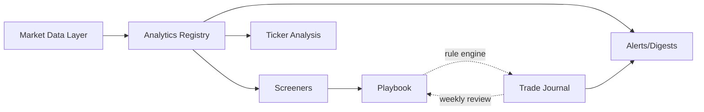

# Chrysos — Features

## Purpose

Chrysos is a personal trading platform built around one goal: enforce a strict, systematic approach to recording and reviewing every trade, so that trading stays consistent and rule-driven.

Everything else in Chrysos exists to support that goal:

- **Journal** — the spine. Every trade is planned, recorded, managed and reviewed against the rules of a playbook.
- **Analytics** — statistics not offered by most brokerage platforms (gamma exposure, forward factor, term structure, etc.).
- **Screeners** — automated nightly scans for trade candidates that match a playbook's entry rules.
- **News and alerts** — configurable news ingestion, session digests and rule-based Discord alerts.

The intended edge is a self-built, near-zero-cost alternative to tools like Unusual Whales, with one advantage those tools cannot have: knowledge of the user's own trades and outcomes, which feeds back into the rules.

## Core principles

1. **Playbooks are the core drivers.** One strategy definition drives the screener, the journal checklist, management alerts and the weekly review.
2. **One rule engine.** Screener filters, entry checks, management rules and alert conditions all use the same rule format and evaluator.
3. **Adapters in front of every external dependency.** Market data, broker, news, LLM and notifications are all behind interfaces so providers can be swapped.
4. **Process over outcome.** Reviews grade how a trade was executed against its plan, separately from whether it made money.
5. **Zero budget first.** Use free data and minimal LLM spend; pay only where the foundations prove a need. LLM spend target is about USD 5 per month.

## Stack and deployment

| Layer         | Choice                                    |
| ------------- | ----------------------------------------- |
| Frontend      | React Router, shadcn/ui                   |
| Charts        | TradingView `lightweight-charts`          |
| Backend       | FastAPI (Python)                          |
| Database      | Postgres                                  |
| Market data   | moomoo OpenAPI via OpenD (first provider) |
| LLM           | OpenAI (behind an adapter)                |
| Notifications | Discord webhooks (in-app later)           |

**Deployment**

- Docker Compose stack: `postgres`, `api`, `worker`, `web`, `opend`.
- Target host: a mini PC running a Proxmox VM. A Raspberry Pi is ruled out: performance aside, OpenD's Linux build appears to be x86-64 only (to verify).
- OpenD has no official Docker image as far as known; community images exist. Before using one, confirm it pulls the official OpenD binary and supports headless first-login phone verification.
- During development, OpenD runs natively on Windows.
- Remote access for the second user is via Tailscale rather than exposing ports publicly.

## Architecture overview



### Adapters

| Interface            | Responsibility                                                     | First implementation     |
| -------------------- | ------------------------------------------------------------------ | ------------------------ |
| `MarketDataProvider` | Quotes, option chains, IV/greeks, price history, earnings calendar | moomoo (OpenD)           |
| `BrokerProvider`     | Positions and fills (read-only)                                    | None yet; interface only |
| `NewsSource`         | Fetch and parse news items                                         | Generic RSS              |
| `LLMProvider`        | Summaries and digests                                              | OpenAI                   |
| `Notifier`           | Deliver alerts and digests                                         | Discord webhook          |

Broker credentials, if ever added, are read-only. Chrysos records trades and never places orders.

## Users and access

- Two users (owner and one friend). No signup UI; users are created with a CLI script.
- Simple session-based login and logout.
- **Private per user:** journals, positions, trade records, playbooks, reviews, alert rules, screeners, digests.
- **Watchlists:** public (visible to all Chrysos users) or private (owner only).
- **Shared globally:** market data cache, chain snapshots, news sources, articles and their summaries.

### User settings

- Timezone
- Soft enforcement on/off
- Discord webhook URL
- Weekly review day and time

## Market data layer

### Responsibilities

- Fetch quotes, option chains (with IV and greeks), price history and earnings dates through `MarketDataProvider`.
- Cache results in Postgres. No universal ticker master table is maintained; tickers are cached on demand.
- Enforce provider quotas with a token-bucket rate limiter. Long jobs spread their calls over time instead of trying to evade limits.
- Log provider calls so quota usage is visible.

### Chain snapshots

- Collect end-of-day chain snapshots from day one, for every watchlist ticker and every open position. Free historical options data is scarce, so Chrysos builds its own history.
- This history later powers indicators that need a lookback (such as IV rank and IV percentile) and backtesting of playbook thresholds.
- Until enough history exists, history-dependent indicators show "insufficient history".
- Expected volume is roughly 15 million option rows per year for about 20 watchlist tickers. Partition snapshot tables by date.

### Data quotas to verify

- moomoo OpenAPI request limits for chain and snapshot calls.
- Whether the moomoo account is entitled to live US options quotes (OPRA).

## Analytics registry

Every indicator or calculator is a plugin registered in code. Each plugin declares:

| Field        | Meaning                                               |
| ------------ | ----------------------------------------------------- |
| `id`, `name` | Identifier and display name                           |
| `version`    | Bumped whenever the formula changes                   |
| `scope`      | `stock`, `option` or `spread`                         |
| `requires`   | Data needed: `chain`, `price_history`, `fundamentals` |
| `params`     | Parameter schema (e.g. front/back DTE targets)        |
| `output`     | `scalar`, `per_strike_series` or `term_curve`         |

Registering a plugin automatically makes it available as:

- a panel on the ticker page (the output type selects the visualisation)
- a filter field in screeners (scalar outputs)
- a value captured in trade entry snapshots
- a condition in playbook rules and alert rules

Snapshots store the indicator version, so historical values are only compared within the same formula version.

### Starter set (MVP)

- **Forward factor.** Forward volatility between two expirations, and its forward factor.
- **IV term structure** across expirations.
- **Expected move** from ATM straddle or IV.
- **Gamma exposure (GEX).** Per-strike GEX, call wall, put wall and gamma flip level. Open interest updates once daily, so GEX is calculated end-of-day. It runs for watchlist tickers and open positions only.

The structure is designed so new stock or option indicators can be added without changes elsewhere.

## Rule engine

A single rule format and evaluator serves four features:

| Feature           | Rules used                         | Evaluated against               |
| ----------------- | ---------------------------------- | ------------------------------- |
| Screener          | Playbook entry rules               | Universe tickers                |
| Soft enforcement  | Playbook entry rules and checklist | Trade entry snapshot and plan   |
| Management alerts | Playbook management rules          | Open positions                  |
| Real-time alerts  | User alert rules                   | News events, prices, indicators |

Example rules:

```
{ "indicator": "forward_factor", "params": { "front_dte": 30, "back_dte": 60 }, "op": ">", "value": 0.2 }
{ "field": "position.pnl_pct", "op": ">=", "value": 25 }
{ "field": "earnings.days_until", "op": "<", "value": 7 }
```

A rule references either an analytics registry indicator or a known field (position state, earnings, price, news). Rules can be combined with `all` / `any` groups.

## Playbooks

A playbook defines a strategy and its rules:

- **Entry rules** — conditions a candidate must meet (e.g. FF > 0.2, no earnings between expirations, minimum open interest, maximum bid-ask spread).
- **Pre-trade checklist** — items to answer before entering (thesis, max loss, planned exit).
- **Management rules** — when to take profit, close or adjust (e.g. close at +25%, close 7 DTE before front expiry).
- **Sizing rules** — e.g. maximum percentage of account per trade.
- **Leg template** — the structure of the trade, used to pre-fill manual entry.

### Templates and user copies

- Default templates (calendar, vertical, etc.) are hardcoded and versioned in code.
- Each user gets their own copy and can tweak thresholds. Overrides are stored on top of the template, so template improvements still flow through to fields the user has not overridden.
- Every playbook change creates a new playbook version. Each trade records the version it was entered under.

### Change control

- **Threshold tweaks** (e.g. FF 0.2 to 0.25) apply immediately and create a new version.
- **Structural changes** (adding or removing a rule or checklist item) are queued as proposals and can only be applied during the weekly review. This prevents rationalising rule changes in the middle of a trade.

## 10. Trade journal

### Model

- A **Position** is one trade idea from plan to close. It belongs to a playbook (and playbook version).
- A Position contains many **Executions**: `open`, `adjust`, `roll`, `close`. Each execution has one or more legs (stock or option fills).
- P&L is tracked across the whole chain of executions, so a rolled calendar stays one position.
- Instruments supported: stocks and options (single legs and spreads).

### Lifecycle

1. **Plan** — choose a playbook, write the thesis, answer the checklist, set max loss, target and planned exit.
2. **Open** — record the opening execution. Chrysos captures an entry snapshot of all relevant indicator values at that moment.
3. **Manage** — record adjustments and rolls; management rules are monitored and alert when triggered.
4. **Close** — record the closing execution; realised P&L is computed.
5. **Review** — graded in the weekly review.

### Manual entry

Fills are entered manually for now. Entry must be fast, because friction undermines consistency:

- Choosing a playbook pre-fills the leg structure from its template.
- Entering ticker and strike fetches the current mark from the data provider; the user corrects it to the actual fill.
- Optional later improvement: parse pasted moomoo order confirmation text.

Automatic fill import through `BrokerProvider` is deferred.

### Soft enforcement

- Each user can toggle enforcement on or off in settings.
- The toggle controls only UI warnings and prompts. Rule violations are always detected and recorded, so review statistics stay complete.
- Violations include: entering without a plan, incomplete checklist, entry snapshot failing entry rules, exiting off-plan, breaching sizing rules.
- Positions opened without a prior plan are flagged as unplanned.

## 11. Weekly review

### Schedule

- Each user sets their own review day and time (default: weekend).
- A Discord reminder links to the review. Once submitted, the review is locked.
- A streak counter tracks consecutive completed reviews.

### Structure

Most of the review is generated automatically so it takes about 15 minutes.

1. **Numbers (auto)** — trades opened and closed, realised P&L, win rate, average win and loss, broken down by playbook.
2. **Adherence (auto)** — percentage of trades with a complete plan, each rule violation and the rule broken, on-plan versus off-plan exits, adherence score trend.
3. **Process grading** — the user grades each closed trade's process (A to F). Chrysos places it in a 2×2 grid:

   |                  | Good outcome             | Bad outcome       |
   | ---------------- | ------------------------ | ----------------- |
   | **Good process** | Repeat                   | Variance — accept |
   | **Bad process**  | Dangerous — flag hardest | Lesson            |

4. **Open positions check** — each open trade against its plan: is the thesis still valid, is it near an exit rule?
5. **Reflection** — what went well, biggest mistake, what to do differently.
6. **Playbook changes** — pending structural proposals are reviewed, then applied or rejected.
7. **Commitment** — one focus for next week. The next review opens by checking whether it was kept.

Optional: an LLM summary of the week's trade notes. Monthly and quarterly views roll up automatically from weekly reviews.

## 12. Watchlists

- A grouping tool for organising tickers.
- Owned by a user, public or private.
- Used to scope chain snapshots, GEX calculation, news relevance and digests.
- Watchlists are not the screener universe.

## 13. Ticker page

The place where every feature meets for a single ticker.

- **Price chart** (`lightweight-charts`) with overlays:
  - news markers on the timeline
  - the user's own entries, adjustments, rolls and exits
  - GEX levels (call wall, put wall, gamma flip) as horizontal price lines
- **Analytics panels** — every applicable registry indicator.
- **Latest digest** content and recent articles for the ticker.
- **Open positions** in the ticker, with plan and rule status.

## 14. Screeners

- Each screener is tied to a playbook; its filters are the playbook's entry rules.
- MVP screeners: calendar spreads and vertical spreads.
- **Universe:** S&P 500 plus liquid optionable names.
- Runs nightly as a background job.

### Two-stage screening

Rate limits are handled by doing less work:

1. **Stage 1 (cheap, whole universe)** — filter on price, average volume, options volume and earnings date using snapshot-level data. Expected to reduce roughly 600 tickers to 50–100.
2. **Stage 2 (expensive, survivors only)** — fetch only the 2–3 expirations near the target DTE and only near-the-money strikes; evaluate the playbook's entry rules.

Calls are spread across the overnight window by the rate limiter.

### From candidate to trade

Selecting a screener result opens a pre-filled trade plan in the journal under that playbook, with the indicator values at screening time attached.

## 15. News and digests

### Sources

- Managed from the UI: add, remove, enable, disable, set poll interval and priority.
- Source types: RSS (generic parser covers most), SEC EDGAR Atom feeds, HTML scrapers where needed.
- Candidate sources: CNBC, MarketWatch, Nasdaq, Fed press releases, SEC EDGAR, per-ticker feeds (Yahoo Finance, Google News). Reuters discontinued its public RSS feeds around 2020 and needs an alternative.
- Avoid scraping the Unusual Whales Discord or site; replicating their calculations from raw data is the cleaner path.

### Ingestion pipeline

The LLM never reads raw articles.

1. Poll sources and deduplicate by URL or title hash.
2. Tag tickers deterministically (cashtags plus a ticker and company-name dictionary).
3. Filter for relevance: open positions, watchlists, screener universe, macro sources.
4. Summarise each relevant article once (headline plus lead paragraph) and cache the summary. Summaries are shared across users and digests.
5. Digests are built from cached summaries plus price moves and position state.

### Session digests

- Four per day, sent when each session starts in US Eastern Time: pre-market, regular hours, post-market, overnight.
- Generated per user, because they reference that user's positions and watchlists.
- Content: relevant news, notable price moves, and management-rule status of open positions (for example "AAPL calendar at +27%, rule says close at 25%"). Suggestions come from playbook rules; the LLM writes the narrative around them.
- Budget: about 120 digest runs per month per user against a USD 5 monthly cap. LLM usage and cost are logged per call, with a budget guard that stops non-essential calls when the cap is near.

## 16. Alerts and notifications

### Real-time alerts (rule-based, no LLM)

- High-importance news on held or watched tickers (8-K filings, trading halts, earnings, keyword matches).
- Management rule triggers on open positions.
- User-defined alert rules using the shared rule format.
- Per-rule cooldown to avoid repeated alerts.

### Delivery

- Discord webhook first; each user has their own webhook.
- In-app notifications are added later as a second `Notifier` channel.
- Every delivery is logged with status and errors.

## 17. Scheduling and time

- All timestamps stored in UTC.
- All market-session logic runs in `America/New_York`, so US daylight saving changes are handled correctly.
- User-facing schedules (weekly review) use each user's own timezone.
- Scheduled jobs: end-of-day chain snapshots, nightly screener, news polling, session digests, management-rule checks, review reminders.

## 18. Delivery phases

### MVP — core loop

1. Auth (two users, CLI-seeded, session login and logout)
2. Data layer (moomoo adapter, rate limiter, cache, end-of-day chain snapshots)
3. Analytics registry with the starter set (forward factor, term structure, expected move, GEX)
4. Rule engine and playbooks (templates, user overrides, versioning, change proposals)
5. Trade journal (positions, executions, plans, entry snapshots, soft enforcement, violations)
6. Ticker page (chart with trade markers and GEX levels, analytics panels)
7. Weekly review

The data layer comes first so chain snapshot history starts accumulating as early as possible.

### MVP+1 — automation

8. Screeners (two-stage, nightly, calendar and vertical)
9. News (configurable sources, ticker tagging, session digests, rule-based Discord alerts, news markers on the ticker page)

## 19. Future prospects

- **SEC filing parser** — read specific sections of filings deterministically to extract structured data quickly.
- **Stock health and profitability score** — an in-house grade based on P/E, margins, revenue and similar fundamentals, usable by alerts.
- **In-app notifications.**
- **Automatic fill import** from moomoo through `BrokerProvider`, with unplanned-trade detection.
- **Parsing pasted moomoo order confirmations** for faster manual entry.
- **Watchlist sharing** with specific users.
- **Additional analytics** (IV rank and percentile once history exists, skew, and others as needed).
