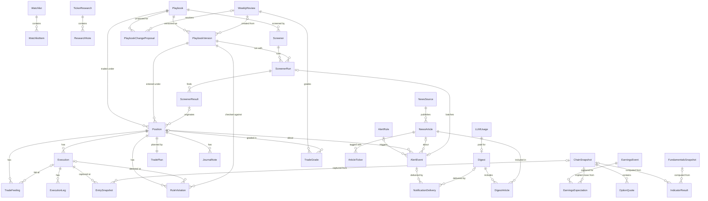

# Data model

Index of the entities to model in the ERD. Each entity's attributes live on the concept page of the feature that owns it, in its "Data model" section. This page holds the conventions every table follows, the index of entities, and the relationships that cross pages.

## Conventions

- Every table has `created_at` / `updated_at` unless noted.
- All timestamps are UTC (see [scheduling and time](../concepts/scheduling-and-time.md)).
- `→ Entity` marks a foreign key. Use the index below to find an entity on another page.
- *(code)* marks items defined in code, not stored as tables, but referenced by keys from tables.
- *(value object, stored as JSONB)* marks a shape stored inside another table's JSONB column, not as a table of its own.
- When adding an entity, put it on the owning concept page, add it to the index, and add its foreign keys to the relationships diagram.

## Index

| Area                  | Page                                                              | Entities                                                                                                                                                                                                                                                                                                                                                                                                                                                                        |
| --------------------- | ----------------------------------------------------------------- | ------------------------------------------------------------------------------------------------------------------------------------------------------------------------------------------------------------------------------------------------------------------------------------------------------------------------------------------------------------------------------------------------------------------------------------------------------------------------------- |
| Users and access      | [users-and-access](../concepts/users-and-access.md#data-model)    | [User](../concepts/users-and-access.md#user), [AuthSession](../concepts/users-and-access.md#authsession)                                                                                                                                                                                                                                                                                                                                                                        |
| Market data           | [market-data](../concepts/market-data.md#data-model)              | [Ticker](../concepts/market-data.md#ticker), [PriceBar](../concepts/market-data.md#pricebar), [EarningsEvent](../concepts/market-data.md#earningsevent), [EarningsExpectation](../concepts/market-data.md#earningsexpectation), [FundamentalsSnapshot](../concepts/market-data.md#fundamentalssnapshot), [ChainSnapshot](../concepts/market-data.md#chainsnapshot), [OptionQuote](../concepts/market-data.md#optionquote), [ProviderCallLog](../concepts/market-data.md#providercalllog) |
| Watchlists            | [market-data](../concepts/market-data.md#data-model)              | [Watchlist](../concepts/market-data.md#watchlist), [WatchlistItem](../concepts/market-data.md#watchlistitem)                                                                                                                                                                                                                                                                                                                                                                    |
| Analytics             | [analytics](../concepts/analytics.md#data-model)                  | [Indicator](../concepts/analytics.md#indicator) *(code)*, [IndicatorResult](../concepts/analytics.md#indicatorresult)                                                                                                                                                                                                                                                                                                                                                           |
| Research              | [analytics](../concepts/analytics.md#data-model)                  | [TickerResearch](../concepts/analytics.md#tickerresearch), [ResearchNote](../concepts/analytics.md#researchnote)                                                                                                                                                                                                                                                                                                                                                                |
| Playbooks             | [playbooks](../concepts/playbooks.md#data-model)                  | [Structure](../concepts/playbooks.md#structure) *(code)*, [Edge](../concepts/playbooks.md#edge) *(code)*, [Addon](../concepts/playbooks.md#addon) *(code)*, [PlaybookPreset](../concepts/playbooks.md#playbookpreset) *(code)*, [Playbook](../concepts/playbooks.md#playbook), [PlaybookVersion](../concepts/playbooks.md#playbookversion), [ChecklistItem](../concepts/playbooks.md#checklistitem) *(value object)*, [PlaybookChangeProposal](../concepts/playbooks.md#playbookchangeproposal) |
| Rules                 | [rule-engine](../concepts/rule-engine.md#data-model)              | [Rule](../concepts/rule-engine.md#rule) *(value object)*                                                                                                                                                                                                                                                                                                                                                                                                                         |
| Journal and trade log | [journal-and-trade-log](../concepts/journal-and-trade-log.md#data-model) | [TradePlan](../concepts/journal-and-trade-log.md#tradeplan), [JournalNote](../concepts/journal-and-trade-log.md#journalnote), [TradeFeeling](../concepts/journal-and-trade-log.md#tradefeeling), [Position](../concepts/journal-and-trade-log.md#position), [Execution](../concepts/journal-and-trade-log.md#execution), [ExecutionLeg](../concepts/journal-and-trade-log.md#executionleg), [EntrySnapshot](../concepts/journal-and-trade-log.md#entrysnapshot), [RuleViolation](../concepts/journal-and-trade-log.md#ruleviolation) |
| Weekly review         | [weekly-review](../concepts/weekly-review.md#data-model)          | [WeeklyReview](../concepts/weekly-review.md#weeklyreview), [TradeGrade](../concepts/weekly-review.md#tradegrade)                                                                                                                                                                                                                                                                                                                                                                |
| Screeners             | [screener](../concepts/screener.md#data-model)                    | [Screener](../concepts/screener.md#screener-1), [ScreenerRun](../concepts/screener.md#screenerrun), [ScreenerResult](../concepts/screener.md#screenerresult)                                                                                                                                                                                                                                                                                                                     |
| News and digests      | [news-and-digests](../concepts/news-and-digests.md#data-model)    | [NewsSource](../concepts/news-and-digests.md#newssource), [NewsArticle](../concepts/news-and-digests.md#newsarticle), [ArticleTicker](../concepts/news-and-digests.md#articleticker), [Digest](../concepts/news-and-digests.md#digest), [DigestArticle](../concepts/news-and-digests.md#digestarticle), [LLMUsage](../concepts/news-and-digests.md#llmusage)                                                                                                                 |
| Alerts                | [alerts](../concepts/alerts.md#data-model)                        | [AlertRule](../concepts/alerts.md#alertrule), [AlertEvent](../concepts/alerts.md#alertevent), [NotificationDelivery](../concepts/alerts.md#notificationdelivery)                                                                                                                                                                                                                                                                                                                 |
| Scheduling            | [scheduling-and-time](../concepts/scheduling-and-time.md#data-model) | [JobRun](../concepts/scheduling-and-time.md#jobrun)                                                                                                                                                                                                                                                                                                                                                                                                                             |
| System                | this page                                                         | [AppSetting](#appsetting)                                                                                                                                                                                                                                                                                                                                                                                                                                                       |

## Relationships

Foreign keys between stored tables. Edges to `User` (every private table has `user_id`) and to `Ticker` (most market tables have `symbol`) are left out to keep the diagram readable.

## AppSetting

Global key/value settings. System-wide, so it has no owning concept page. Secrets such as the Discord webhook URL are environment variables, not settings (see [architecture.md](../architecture.md#notifications)).
- `key`
- `value` (JSONB)

Example keys: `llm_monthly_budget_usd`, `universe_refresh_schedule`.
